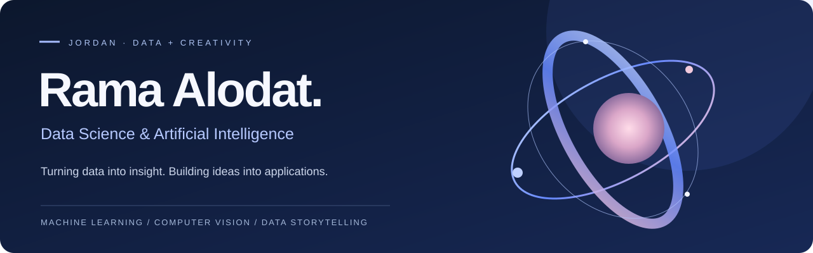
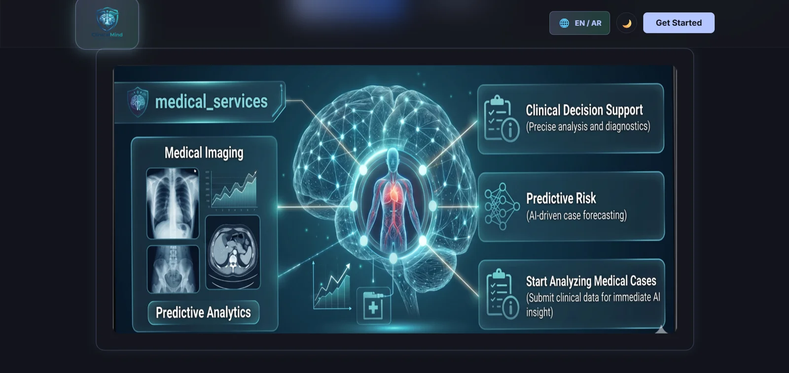
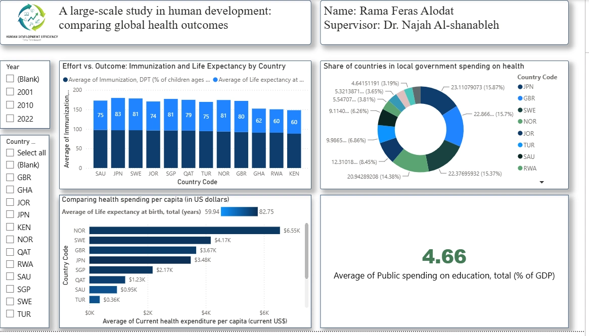
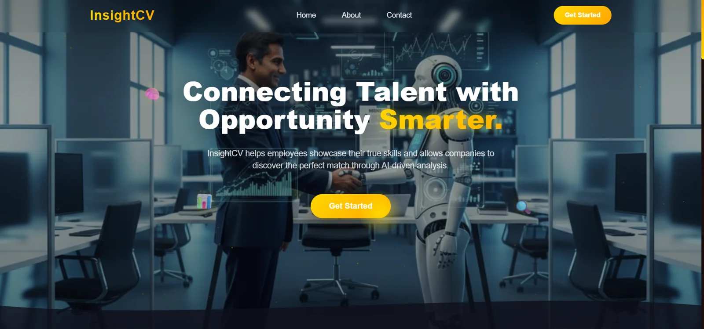
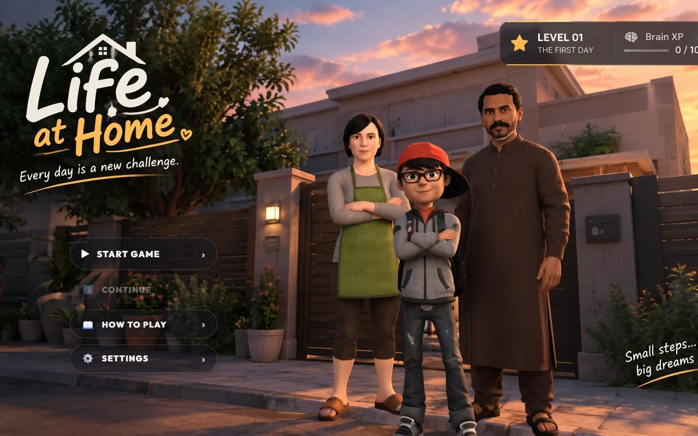

  

  <a href="https://ramaalodat.github.io/rama-portfolio/"><strong>EXPLORE MY PORTFOLIO ↗</strong></a>
  &nbsp; · &nbsp;
  <a href="https://www.linkedin.com/in/rama-alodat-686aa932a">LinkedIn</a>
  &nbsp; · &nbsp;
  <a href="mailto:ramaferas2005@gmail.com">Email</a>

### An analytical mind. A creative perspective.

I’m **Rama**, a Data Science & Artificial Intelligence student at **Al al-Bayt University**, based in Jordan. I build practical applications, explore machine learning and computer vision, and turn data into clear visual stories.

My work spans healthcare AI, intelligent travel assistance, career tools, and interactive analytics. I enjoy the full process: understanding a problem, working with data, building a solution, and making it useful to the person using it.

**Currently:** Fourth year · Expected graduation **2027**  
**Focus:** Machine learning · Computer vision · Data analysis · Intelligent applications

---

### Selected work

Real screens from my projects. Explore the code, or visit the portfolio for the complete galleries.

<table>
<tr>
<td width="50%" valign="top">

<h3>Medical AI Diagnostic Assistant</h3>

Preliminary symptom analysis and medical image classification, including brain scans, chest images, and bone X-rays.

Python · Machine Learning · Deep Learning · Computer Vision

<a href="https://github.com/Ramaalodat/MedAssist-AI"><strong>Explore repository ↗</strong></a>

</td>
<td width="50%" valign="top">

<h3>Human Development Explorer</h3>

My original two-page Power BI report on health, education spending, and essential services across 12 countries.

Power BI · Power Query · Data Visualization

<a href="https://ramaalodat.github.io/rama-portfolio/demos/powerbi/"><strong>View original report ↗</strong></a> · <a href="https://github.com/Ramaalodat/powerbi">Repository</a>

</td>
</tr>
<tr>
<td width="50%" valign="top">

<h3>InsightCV</h3>

An AI-driven CV improvement and interview preparation platform. A collaborative team project.

PHP · Node.js · HTML · MongoDB

<a href="https://github.com/Ramaalodat/Project-InsightCV"><strong>Explore repository ↗</strong></a>

</td>
<td width="50%" valign="top">

<h3>Life at Home</h3>

A browser game you can explore and play directly online.

Playable browser experience

<a href="https://antigravity-life.vercel.app"><strong>Play the game ↗</strong></a>

</td>
</tr>
</table>

**More to explore**

| Project | Purpose | Repository |
|---|---|---|
| **Pathfinder AI** | Intelligent travel planning and assistance · team project | [Explore ↗](https://github.com/Ramaalodat/PathFinder-AI) |
| **Smart City Assistant** | Parking occupancy prediction and visit-time recommendations | [Explore ↗](https://github.com/Ramaalodat/Smart_parking) |
| **Alpha** | Financial goal tracking and planning | [Explore ↗](https://github.com/Ramaalodat/alphav3) |
| **تبرّع — Donation Platform** | Bilingual Arabic and English donation workflows · team project | [Explore ↗](https://github.com/Ramaalodat/TBR3) |

[**See all nine projects, recordings, and galleries in my portfolio →**](https://ramaalodat.github.io/rama-portfolio/#projects)

### Tools behind the work

| Area | Tools & skills |
|---|---|
| **AI & data** | Python · Pandas · Scikit-learn · Machine Learning · Computer Vision · Power BI |
| **Applications** | Flutter · Node.js · PHP · HTML · CSS · Java · C++ |
| **Data & workflows** | SQL · MySQL · MongoDB · Firebase · Flowise · Git & GitHub |

### Learning, experience & community

- Completed the **DecodeLabs AI Virtual Internship**, with a certificate and recommendation letter.
- Passed **Phase 1 — Concept Evaluation** in **Fintech Rally 2026 University Edition**, JOIN Fincubator.
- Delivered an **AI awareness workshop for school students**.
- Gained experience in **data entry, record organization, and administrative operations** at the Directorate of Culture.
- Completed **15 hours of Soft Skills Training** with Robotna in collaboration with STEM.

[Explore my certificates and learning journey ↗](https://ramaalodat.github.io/rama-portfolio/#certificates)

### Beyond the code

Drawing and creative writing shape how I approach technology: with curiosity, attention to detail, and a sense of story. My short story **«هائمٌ في ما ليس لي»** won **third place** in Al al-Bayt University’s short story competition.

---

<strong>Let’s build something thoughtful.</strong> 
<a href="mailto:ramaferas2005@gmail.com">ramaferas2005@gmail.com</a> · <a href="https://www.linkedin.com/in/rama-alodat-686aa932a">LinkedIn</a> · <a href="https://ramaalodat.github.io/rama-portfolio/">Portfolio</a>

